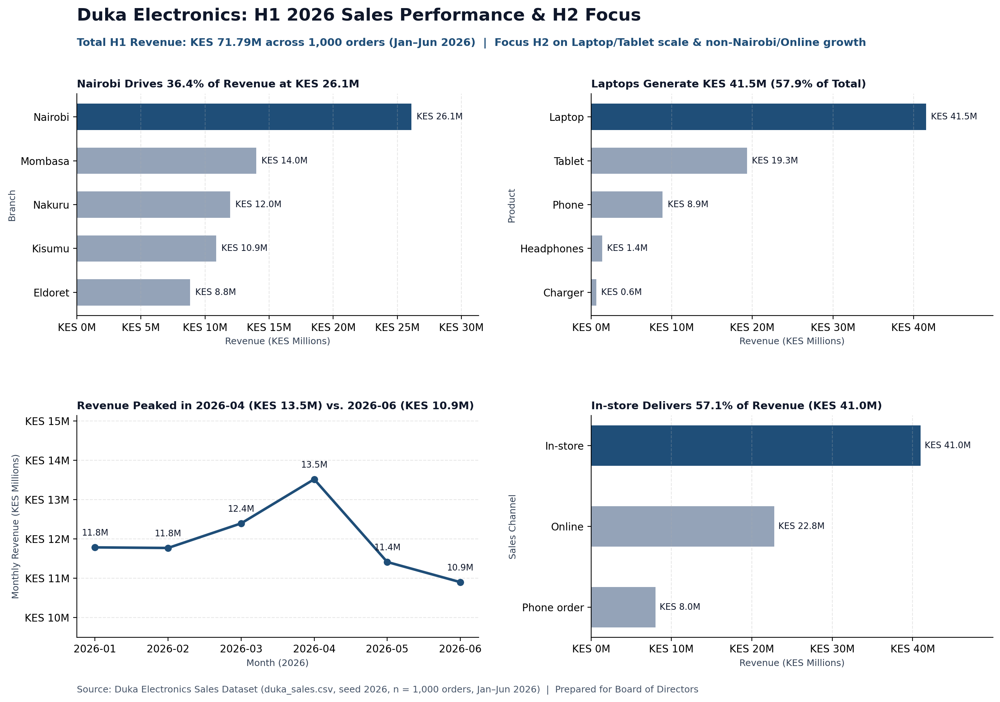

# Student Performance EDA & Duka Electronics Board Report (`plp-da-a4-student-eda-and-board-report`)

## Overview & How to Run
This repository covers two Week 4 engagements:
1. **Engagement 1 — County Education Office (`student_eda.ipynb`):** Exploratory analysis of `student_performance.csv` (1,200 students, seed `55`) across `Structure`, `Univariate`, `Bivariate`, `Multivariate`, and `Hypotheses`, with `average_score` and `performance_band` columns, correlation matrix, school-type pivot tables, `study_hours` trend line (`np.polyfit`), three exported charts in `figures/`, and `Findings`, `Recommendations`, and `Limitations`.
2. **Engagement 2 — Duka Electronics Board Report (`board_report.ipynb` & `dashboard.md`):** Mobile-friendly one-page board visual report (`reports/duka_board_report.png`) for H1 2026 (`duka_sales.csv`, 1,000 orders, seed `2026`), a before-and-after chart makeover (`figures/before.png` and `figures/after.png`), and a Looker Studio dashboard (`dashboard.md`).

### Running the Code
1. Install dependencies from `requirements.txt` (`pandas`, `numpy`, `matplotlib`, `seaborn`).
2. Run `python generate_data.py` to generate `student_performance.csv` (seed `55`) and `duka_sales.csv` (seed `2026`).
3. Run `student_eda.ipynb` and `board_report.ipynb` from top to bottom with all cell outputs visible.

---

## Five Key EDA Insights
1. **Attendance & Study Hours Align with Higher Scores:** Both `attendance_rate` and `study_hours` show positive correlations with `average_score`, highlighting attendance and study habits as key levers to explore for learner support.
2. **School-Type Score Gap Persists:** Private school students record higher mean scores than Public school students across attendance bands and study-hour quartiles.
3. **County Risk Levels Differ:** The share of **At Risk** learners (`average_score < 60`) varies across the six counties, helping identify where support is most needed.
4. **Performance Bands Clarify Learner Needs:** Grouping `average_score` into **At Risk** (`< 60`), **Meeting** (`60–74`), and **Exceeding** (`>= 75`) separates learners needing immediate intervention from those on track or excelling.
5. **Study-Hours Distribution Has High-Hour Outliers:** `study_hours` is right-skewed with upper-tail outliers beyond the IQR fence, which should be kept in mind alongside score bounds (`0–100`) when interpreting linear trend estimates.

---

## One-Page Board Report

---

## Board Summary
Duka Electronics recorded strong first-half 2026 sales across 1,000 orders from January through June 2026, generating **KES 71,792,500** in total revenue. Performance was led by **Nairobi** (**KES 26,106,100** across **376** orders, or **36.36%** of revenue) and by **Laptops** on revenue (**KES 41,535,000** from **639** units), while **Tablets** led total units sold (**691** units, generating **KES 19,348,000**). Monthly revenue reached its high point in **April 2026** (**KES 13,518,300**) and its low point in **June 2026** (**KES 10,903,400**), a **23.98%** difference between best and worst months. For the second half of 2026, the board should focus on keeping high-demand devices like Laptops and Tablets well stocked, supporting stronger performance in regional branches outside Nairobi, growing online and phone channels, and planning promotions ahead of softer mid-year months.
